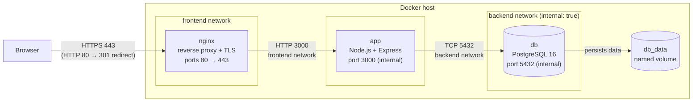

# TaskVault – Architecture

## Diagram



Only nginx publishes ports to the host. The app and db have **no published ports**.
The app is the only container attached to **both** networks.

## Components – why each one exists

| Component | Role | Why it exists |
|---|---|---|
| **nginx** (`nginx:1.30.3-alpine`) | Reverse proxy. Terminates TLS, redirects HTTP → HTTPS, adds security headers, forwards to the app. | One hardened entry point. TLS and headers are handled by a tool built for it, so the Node.js process never faces the network directly. |
| **app** (`node:26.13.1-alpine`) | REST API (`/api/tasks`), static page, `/health`. Runs as non-root user `node`. | The business logic. It's stateless (all data is in the db), so it can be restarted or replaced at any time. |
| **db** (`postgres:16.15-alpine`) | Stores tasks. Initialised once by `db/init.sh` + `db/init.sql`. | Reliable relational storage. The app connects with a **limited user** that can only read/write rows in `tasks`. |
| **db_data** (named volume) | PostgreSQL's data directory. | Data survives container restarts, rebuilds and `docker compose down`. Only `down -v` deletes it. |

## Networks – the security boundary

| Network | Members | Internal? | Effect |
|---|---|---|---|
| `frontend` | nginx, app | no | nginx can reach the app. |
| `backend` | app, db | **yes** | Only the app can reach the db. The db has no route to the internet. |

Verified on the running stack:
- `nginx → db`: `nc: bad address 'db'`. nginx can't even resolve the db's name.
- `db → internet`: `wget: bad address 'example.com'`.
- `docker compose port db 5432`: no published port.

## Request flow (example: mark task 3 as done)

1. The browser sends `PUT https://localhost/api/tasks/3` with `{"status":"done"}`.
2. nginx decrypts TLS, adds `X-Forwarded-*` headers and forwards to `http://app:3000/api/tasks/3`. Docker DNS resolves `app`.
3. Express validates the id and status, then runs `UPDATE tasks SET status = $1 WHERE id = $2` as a **parameterized** query.
4. PostgreSQL checks the `CHECK (status IN ('todo','done'))` constraint and updates the row.
5. The JSON response goes back through nginx, encrypted again, with security headers added.

## Startup order and health

```
db  (healthy: pg_isready over TCP)  →  app  (healthy: GET /health runs SELECT 1)  →  nginx
```

- `depends_on: condition: service_healthy` enforces this order.
- The app also **retries** the db connection 10 times at startup, logging each attempt. If every attempt fails, it exits with code 1 and `restart: unless-stopped` starts it again.
